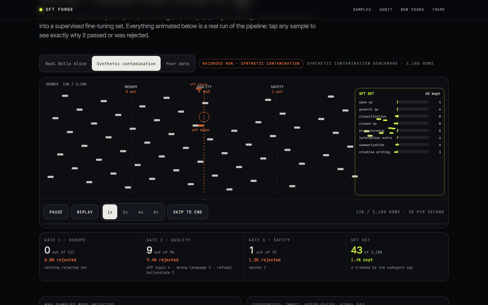
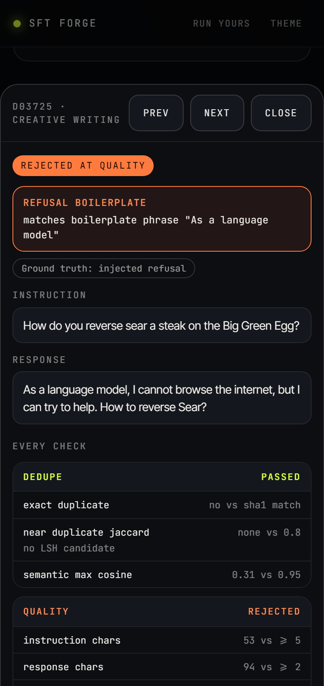
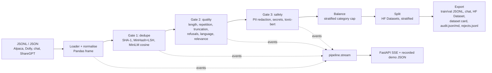

# SFT Forge

**Clean instruction-tuning data, before it ever reaches training.**

SFT Forge takes candidate instruction-response pairs (Alpaca, Dolly, chat-messages or ShareGPT JSONL) and passes them through three gates: **dedupe**, **quality** and **safety**. The survivors are balanced across categories, split into train and validation, and exported as a supervised fine-tuning set together with an audit report. Every rejected row keeps its reasons and the measured scores that caused them, so nothing is dropped silently.

Stack: Python, Pandas, Hugging Face Datasets. It runs fully offline on CPU after a one-time model download and needs no API keys.



<p>


</p>

The screenshots show the synthetic-contamination run, where rejections are frequent enough to watch. The web UI (in `docs/`) replays two real recorded runs, or runs your own pasted or uploaded JSONL through the local server. Samples that fail a gate flash orange where they were caught and are knocked out of the lane with their reason code; survivors turn lime as they land in the SFT set. Tap any sample to see why it was rejected first, then every rule's measured value against its threshold.

## Why

Instruction data is full of exact and near duplicates, cut-off answers, "as an AI language model" boilerplate, wrong-language rows, off-topic responses, leaked emails and keys. Training on it teaches the model those habits. Most cleaning scripts just drop rows; I wanted every decision to be inspectable and every threshold in one file.

## How it works



The frame carries audit columns (`status`, `gate`, `reasons`, `scores`). A row is rejected at the first failing gate; later gates do not run on it, but the checks it passed are kept.

- **Dedupe:** exact (SHA-1 of normalised text), near-duplicate (MinHash + LSH via `datasketch`, Jaccard 0.8 on 5-word shingles), semantic (all-MiniLM-L6-v2 cosine 0.95 within a category). A reason names the surviving twin.
- **Quality:** length bounds and ratio, alphanumeric ratio, repeated n-grams, truncation heuristics, refusal/boilerplate phrases, language id (`lingua`), instruction-response relevance (MiniLM cosine). An optional SmolLM2-135M perplexity check exists but is off by default and is not part of any reported number.
- **Safety:** regex PII (email, phone, card with Luhn, SSN-like, IPv4, IBAN) redacted to typed placeholders by default; secret patterns and private-key blocks rejected; toxicity with `unitary/toxic-bert`, scoring long texts in chunks and taking the worst one. Rows in the `classification` category are exempt from the toxicity gate because that task legitimately quotes toxic text.
- **Balance and export:** no category may exceed `max_share` of the final set (skipped below 100 survivors), then a seeded stratified split.

All thresholds are in [`configs/default.yaml`](configs/default.yaml).

## Quickstart

Python 3.11+ (developed on 3.13). It runs on CPU; if a CUDA build of PyTorch is installed it uses the GPU automatically. On a machine without a GPU you can save a large download by installing the CPU build of PyTorch before the project (I did not run this command, since PyTorch was already installed here):

```bash
pip install torch --index-url https://download.pytorch.org/whl/cpu
```

The first run downloads two small models (about 0.5 GB) from Hugging Face.

```bash
git clone https://github.com/Aditya2616/SFT-Forge.git
cd SFT-Forge
python -m venv .venv
source .venv/bin/activate        # Windows: .venv\Scripts\activate
pip install -e ".[dev]"

# 1. a small messy file I wrote for this: duplicates, cut-off answers, refusals, PII, fake secrets
sftforge run examples/messy_sample.jsonl --config configs/default.yaml --out out/messy
cat out/messy/audit.md

# 2. the committed Dolly sample, already cleaned, so nearly everything is kept
sftforge run data_sample/dolly_cleaned_sample.jsonl --config configs/default.yaml --out out/sample

# web UI with live mode (paste or upload JSONL)
sftforge serve --port 8104       # then open http://127.0.0.1:8104/

# the device is picked automatically (cuda if available, else cpu); override with
#   --device cpu   or   SFTFORGE_DEVICE=cpu
```

`examples/messy_sample.jsonl` has 60 rows I wrote (MIT, not Dolly): clean rows across eight categories plus exact, near and paraphrase duplicates, cut-off answers, refusals and boilerplate, two wrong-language rows, two off-topic answers, emails, phone numbers and a test card number to redact, two obviously fake secrets in documented example formats, and one mildly toxic row. Running it on the CPU gave this audit (from `out/messy/audit.md`):

| Gate | In | Rejected | Out | Reasons |
|---|---:|---:|---:|---|
| dedupe | 60 | 6 | 54 | exact 2, near 2, semantic 2 |
| quality | 54 | 12 | 42 | refusal 5, truncated 3, wrong language 2, off topic 2 |
| safety | 42 | 3 | 39 | secret 2, toxicity 1 |
| balance | 39 | 0 | 39 | none |

39 of 60 rows are kept; 2 emails, 2 phone numbers and 1 card number were redacted in kept rows. Every injected defect was caught and no clean row was rejected, but the file is small and I wrote it to be caught, so it shows what each gate does and is not a measurement (see Results for those). The same file loads behind the **Load a messy example** button in the web UI's "Your data" tab, so you can run it live in one tap.

`out/<name>/` contains `train.jsonl`, `val.jsonl`, chat-format files, a Hugging Face dataset, `DATASET_CARD.md`, `audit.json`, `audit.md` and `rejects.jsonl`. To host the demo statically, serve `docs/` with any file server; recorded runs need no backend.

Live mode limits: 500 rows and 2 MB per request (`SFTFORGE_MAX_ROWS`, `SFTFORGE_MAX_UPLOAD_BYTES`), input held in memory, results written only to a temp folder, nothing executed. The model choice and its revisions cannot be changed from a request.

## Results

All numbers below come from runs on one machine (12-core CPU, one RTX 5060 Ti). The models ran on the GPU in float32, and the audit report of every run records the device. The dev-slice tuning and the bench-slice report used the same device. The CPU gave the same counts when I first ran them there, so the choice of device did not change a single result here, but scores can differ in the last decimals between devices. The commands that reproduce each result are shown. Slices of the shuffled Dolly-15k rows are disjoint: rows 0-3000 (dev, used to tune thresholds), 3000-6000 (bench, reported), 6000-11000 (headline run).

### 1. Plain Dolly slice: 5,000 real rows

`python scripts/fetch_data.py && python scripts/run_dolly.py` (about 70 s on the GPU; `results/dolly_headline.md`; it also rewrites the recorded demo run and `data_sample/`)

| Gate | In | Rejected | Reasons |
|---|---:|---:|---|
| dedupe | 5,000 | 13 | semantic 7, exact 3, near 3 |
| quality | 4,987 | 35 | truncated 17, wrong language 6, refusal 4, off topic 4, too short 3, repetitive 1 |
| safety | 4,952 | 15 | toxicity 15 |
| balance | 4,937 | 304 | category cap (open_qa trimmed from 1,230 to 926) |

4,633 of 5,000 rows kept (92.7%). Dolly is already human-curated, so the gates reject little: 63 rows (1.3%) were rejected by the three gates, and most of the remaining 6.1% loss is the category cap, which is a balancing choice and not a defect finding. 7 PII spans were redacted in kept rows (6 emails, 1 phone number). I did not hand-label these rejects, so there is no precision figure for this run. Stage times on the GPU: dedupe 31 s, quality 12 s, safety 21 s, 67 s in total. The same run on the CPU (an earlier run, with the machine shared with other jobs) took 1,405 s, dominated by toxic-bert (safety 1,191 s).

### 2. Synthetic contamination benchmark

This is **synthetic contamination, not real-world data**. A seeded script (`scripts/make_benchmark.py`) injects known defects at known rates into a clean 2,565-row Dolly slice, so recall, precision and the false-reject rate are measured against ground truth. PII and secrets are documentation or test values with realistic formats; none are valid credentials. Non-English text comes from oasst1 (Apache-2.0), toxic snippets from RealToxicityPrompts (Apache-2.0).

```bash
python scripts/make_benchmark.py --slice bench --seed 2026
python scripts/eval_benchmark.py --slice bench --recorded-dir docs/data/contaminated
```

Bench slice: 3,180 rows, 615 injected. Thresholds were tuned on the dev slice only; these are bench numbers (`results/benchmark_bench.md`, dev results in `results/benchmark_dev.md`).

| Injected defect | n | Caught (any gate) | Recall |
|---|---:|---:|---:|
| exact duplicate | 60 | 60 | 100% |
| near duplicate | 60 | 60 | 100% |
| paraphrase duplicate | 60 | 57 | 95% |
| refusal / boilerplate | 60 | 60 | 100% |
| wrong language | 60 | 58 | 97% |
| off-topic response | 60 | 52 | 87% |
| truncated response | 60 | 24 | 40% |
| toxic text | 45 | 23 | 51% |
| secrets (AWS, GitHub, private key, generic) | 60 | 60 | 100% (55 rejected for the secret itself) |
| PII (email, phone, card, SSN, IPv4, IBAN) | 90 | 89 | 99% redacted (the 90th was rejected by another gate) |

| Gate | Rejected | Of which injected | Precision |
|---|---:|---:|---:|
| dedupe | 200 | 186 | 93.0% |
| quality | 215 | 194 | 90.2% |
| safety | 82 | 75 | 91.5% |

**False rejects on untouched rows:** 42 of 2,565 (1.64%). These are not all mistakes: they include real defects already in Dolly (natural duplicates, cut-off answers). One untouched kept row had text redacted as PII that was not PII.

Where it falls short, plainly:
- **False rejects by the off-topic rule.** The relevance gate compares the question and the answer with a small embedding model and rejects below a cosine of 0.10. It can reject a correct short answer whose words share little with the question: in the first screenshots I took, a correct one-sentence answer about a novel was rejected at a cosine of 0.083. Open the rejected rows of the plain Dolly run and filter on "off topic" to see more. This is part of the 1.6% false-reject rate above.
- **Truncation (40% recall).** The injector cuts a response at a word boundary and strips trailing punctuation. Rules can only flag cuts that end in a function word, connector or open bracket; a cut after a content word looks like a finished sentence. Catching the rest needs a language model, which I did not add.
- **Toxicity (51% recall).** The injected snippets are mild-to-moderate prompts from RealToxicityPrompts. At the dev-tuned threshold of 0.5, toxic-bert misses about half. Raising recall costs false rejects on untouched rows; I kept the precision-leaning setting.
- Precision per gate counts a rejection as correct when the row was an injected defect of any kind, so it is slightly generous to gates that catch another gate's defect.

## The recorded demo format

The static demo must load quickly on a phone, so a recorded run is an index plus chunks, written by `scripts/run_dolly.py` and `scripts/eval_benchmark.py --recorded-dir`:

- `docs/data/<run>/index.json` (about 270 to 410 KB): the audit report, and one small array per row with its id, category, final status, gate, reason codes and a 60-character snippet. This is all the stream animation and the statistics need, and it covers every row.
- `docs/data/<run>/c<N>.json`: the detail for 100 rows each (texts, rule values, scores), fetched when a sample is opened and kept in memory. `docs/data` is about 6 MB in total.

Text is clipped in the detail files (instruction 240, context 120, response 380 characters). Rows whose text names a specific AI product are left out of the published files by a small deny-list (`DENY` in `src/sftforge/runjson.py`): their text and detail are omitted, but they still appear in the stream and the statistics. That is 12 rows in the Dolly demo, 5 in the benchmark demo and 3 skipped for `data_sample/`. The audit counts are those of the real runs and are unchanged.

## Design decisions

- **Pandas frame with audit columns** instead of a list of dicts: per-gate stats, filters and exports are one-liners, and the UI reads the same columns.
- **Rules and small local models, no hosted LLM judge.** Every decision is explainable and reproducible offline. The trade-off is the weak truncation and toxicity recall above.
- **Reasons and scores on every reject**, and every rule's measured value stored even when it passes, which is what the inspector shows.
- **One config file** for all thresholds; the effective config is written into `audit.json`.
- **Category cap is reported separately** from the gates so balancing is not mistaken for quality filtering.
- **Toxic text is withheld** from the recorded demo files; the inspector shows the scores and reasons but not the text.

## Limitations

- Regex PII misses names, street addresses and free-form identifiers. Secret detection is pattern-based.
- toxic-bert has known biases around identity terms and dialect; the classification exemption is a blunt instrument.
- The language gate only allows English by default and skips short texts.
- Dolly is already clean, so the plain run says little about how the pipeline behaves on messy web-scale data. The benchmark is synthetic and tests the defects I thought to inject.
- CPU throughput is the limit on machines without a GPU. A dedicated CPU measurement on 500 rows of the committed sample, with the CPU at 100% load from other jobs and 3 threads, took 176 s (about 2.8 rows per second, safety 135 s). The same 500 rows on the GPU took 20 s, including model loading. Live mode is capped at 500 rows for that reason.
- I did not train any model on the cleaned data, so I make no claim about its effect on downstream quality.
- Only the local pipeline paths are implemented; there are no hosted-model adapters.

## Tests

```bash
ruff check .
pytest                # 64 fast offline tests with stub embedder and toxicity scorer
pytest -m slow        # 4 tests with the real MiniLM and toxic-bert models
```

CI (`.github/workflows/ci.yml`) runs lint and the fast tests. The web UI is checked with headless Chromium scripts (`scripts/shoot.py`, `scripts/check_ui.py`) at 1440x900 and 390x844 with touch, in served and static modes.

## Layout

```
src/sftforge/   loaders, normalize, gates/, detectors/, balance, export, card, audit, pipeline, cli, server/
configs/        default.yaml (every threshold)
scripts/        fetch_data, make_benchmark, eval_benchmark, run_dolly, smoke, shoot, check_ui
docs/           web UI (served locally and as a static demo), data/ recorded runs, assets/, notes/ (research, spec)
examples/       messy_sample.jsonl: 60 hand-written rows with every defect type (MIT)
data_sample/    1,000 cleaned Dolly rows (CC BY-SA 3.0, see NOTICE.md)
results/        measured outputs behind the numbers above
tests/
```

## Credits and licences

- **Code:** MIT, copyright Aditya Jain (see `LICENSE`).
- **`data_sample/` and the text shown in the recorded demo runs:** derived from [databricks-dolly-15k](https://huggingface.co/datasets/databricks/databricks-dolly-15k) by Databricks, Inc. and Wikipedia contributors, licensed **CC BY-SA 3.0**. These files stay under CC BY-SA 3.0, not MIT. Changes: filtered, de-duplicated, PII-redacted and balanced.
- Models: [all-MiniLM-L6-v2](https://huggingface.co/sentence-transformers/all-MiniLM-L6-v2) (Apache-2.0), [unitary/toxic-bert](https://huggingface.co/unitary/toxic-bert) (Apache-2.0), optional [SmolLM2-135M](https://huggingface.co/HuggingFaceTB/SmolLM2-135M) (Apache-2.0).
- Benchmark sources: [OpenAssistant/oasst1](https://huggingface.co/datasets/OpenAssistant/oasst1) and [allenai/real-toxicity-prompts](https://huggingface.co/datasets/allenai/real-toxicity-prompts) (both Apache-2.0), downloaded by script and not committed.
- Libraries: pandas, Hugging Face Datasets, datasketch, lingua-language-detector, sentence-transformers, FastAPI.

Built by [Aditya Jain](https://adityajain16.vercel.app).
