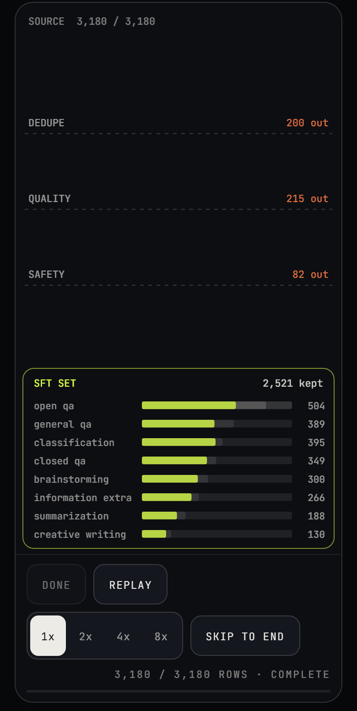
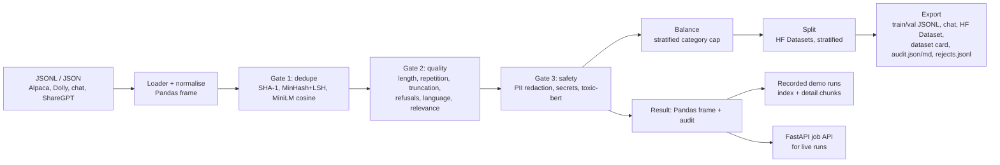
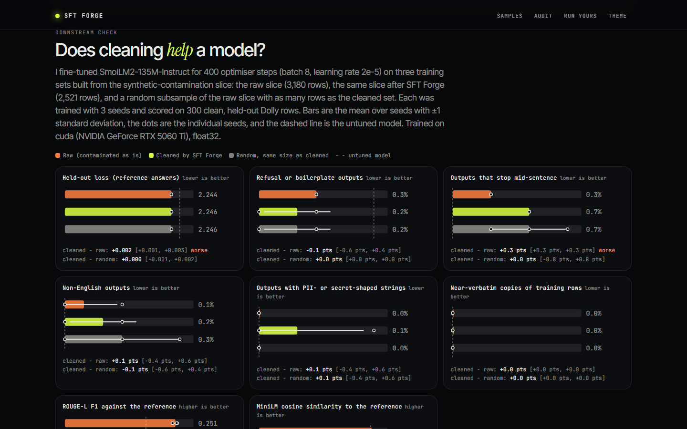

# SFT Forge

[](https://github.com/Aditya2616/SFT-Forge/actions/workflows/ci.yml)
[](LICENSE)

By [Aditya Jain](https://adityajain16.vercel.app) and [Sneha Singh](https://github.com/snehasingh2608).

**Clean instruction-tuning data, before it ever reaches training.**

SFT Forge takes candidate instruction-response pairs (Alpaca, Dolly, chat-messages or ShareGPT JSONL) and passes them through three gates: **dedupe**, **quality** and **safety**. The survivors are balanced across categories, split into train and validation, and exported as a supervised fine-tuning set together with an audit report. Every rejected row keeps its reasons and the measured scores that caused them, so nothing is dropped silently.

On the one downstream test I ran (a 135M model, three seeds), cleaning made no practical difference; the gates are measured against injected defects, not shown to improve models (see Results).

Stack: Python, Pandas, Hugging Face Datasets. It runs fully offline on CPU after a one-time model download and needs no API keys.


<p>


</p>

The screenshots show the synthetic-contamination run, where rejections are frequent enough to watch. The web UI (in `docs/`) replays two real recorded runs, or runs your own pasted or uploaded JSONL through the local server. Samples that fail a gate flash orange where they were caught and are knocked out of the lane with their reason code; survivors turn lime as they land in the SFT set. Tap any sample to see why it was rejected first, then every rule's measured value against its threshold.

## Why

Instruction data is full of exact and near duplicates, cut-off answers, "as an AI language model" boilerplate, wrong-language rows, off-topic responses, leaked emails and keys. Training on it teaches the model those habits. Most cleaning scripts just drop rows; I wanted every decision to be inspectable and every threshold in one file.

## How it works



The frame carries audit columns (`status`, `gate`, `reasons`, `scores`). A row is rejected at the first failing gate; later gates do not run on it, but the checks it passed are kept.

- **Dedupe:** exact (SHA-1 of normalised text), near-duplicate (MinHash + LSH via `datasketch`, Jaccard 0.8 on 5-word shingles), semantic (all-MiniLM-L6-v2 cosine 0.95 within a category). A reason names the surviving twin.
- **Quality:** length bounds and ratio, alphanumeric ratio, repeated n-grams, truncation heuristics, refusal/boilerplate phrases, language id (`lingua`), instruction-response relevance (MiniLM cosine). An optional SmolLM2-135M-Instruct perplexity check exists; I measured it (section 3 of the results) and it stays off by default.
- **Safety:** regex PII (email, phone, card with Luhn, SSN-like, IPv4, IBAN) redacted to typed placeholders by default; secret patterns and private-key blocks rejected; toxicity with `unitary/toxic-bert`, scoring long texts in chunks and taking the worst one. Rows in the `classification` category are exempt from the toxicity gate because that task legitimately quotes toxic text.
- **Balance and export:** no category may exceed `max_share` of the final set (skipped below 100 survivors), then a seeded stratified split.

All thresholds are in [`configs/default.yaml`](configs/default.yaml).

## Results

All numbers below come from the results files named next to them, and `scripts/check_numbers.py` checks that the README matches those files. The commands that reproduce each result are shown.

<!-- gen:device -->
The headline run and the benchmark ran on one machine (12 logical cores, one shared RTX 5060 Ti). The models ran on the GPU in float32 (audit device: `cuda (NVIDIA GeForce RTX 5060 Ti), float32`). Scores can differ in the last decimals between devices; the dev-slice tuning and the bench-slice report used the same device.
<!-- /gen:device -->

<!-- gen:slices -->
Slices of the shuffled Dolly-15k rows are disjoint: rows 0-3000 (dev, used to tune thresholds), 3000-6000 (bench, reported), 6000-11000 (headline run).
<!-- /gen:slices -->

### 1. Plain Dolly slice: 5,000 real rows

`python scripts/fetch_data.py && python scripts/run_dolly.py` (`results/dolly_headline.md`; it also rewrites the recorded demo run and `data_sample/`)

<!-- gen:dolly -->
| Gate | In | Rejected | Out | Reasons |
|---|---:|---:|---:|---|
| dedupe | 5,000 | 13 | 4,987 | semantic 7, exact 3, near 3 |
| quality | 4,987 | 35 | 4,952 | truncated 17, wrong language 6, off topic 4, refusal 4, too short 3, repetitive 1 |
| safety | 4,952 | 15 | 4,937 | toxicity 15 |
| balance | 4,937 | 304 | 4,633 | category cap (open_qa trimmed from 1,230 to 926) |

4,633 of 5,000 rows kept (92.7%). Dolly is already human-curated, so the gates reject little: 63 rows (1.3%) were rejected by the three gates, and the other 304 (6.1%) were trimmed by the category cap, which is a balancing choice and not a defect finding. 7 PII spans were redacted in kept rows (6 emails, 1 phone number). I did not hand-label these rejects, so there is no precision figure for this run. Stage times on the GPU: dedupe 31 s, quality 12 s, safety 21 s, 67 s in total.
<!-- /gen:dolly -->

### 2. Synthetic contamination benchmark

This is **synthetic contamination, not real-world data**. A seeded script (`scripts/make_benchmark.py`) injects known defects at known rates into a clean slice of Dolly rows, so recall, precision and the false-reject rate are measured against ground truth. PII and secrets are documentation or test values with realistic formats; none are valid credentials. Non-English text comes from oasst1 (Apache-2.0), toxic snippets from RealToxicityPrompts (Apache-2.0).

```bash
python scripts/make_benchmark.py --slice bench --seed 2026
python scripts/eval_benchmark.py --slice bench --recorded-dir docs/data/contaminated
```

<!-- gen:bench_intro -->
Bench slice: 3,180 rows, 615 of them injected defects and 2,565 left untouched. Thresholds were tuned on the dev slice only; these are bench numbers (`results/benchmark_bench.md`, dev results in `results/benchmark_dev.md`).
<!-- /gen:bench_intro -->

<!-- gen:bench_recall -->
| Injected defect | n | Caught (any gate) | Recall |
|---|---:|---:|---:|
| exact duplicate | 60 | 60 | 100% |
| near duplicate | 60 | 60 | 100% |
| paraphrase duplicate | 60 | 57 | 95% |
| refusal / boilerplate | 60 | 60 | 100% |
| wrong language | 60 | 58 | 97% |
| off-topic response | 60 | 52 | 87% |
| truncated response | 60 | 24 | 40% |
| toxic text | 45 | 23 | 51% |
| secrets (AWS, GitHub, private key, generic) | 60 | 60 | 100% (55 rejected for the secret itself) |
| PII (email, phone, card, SSN, IPv4, IBAN) | 90 | 89 | 99% redacted (1 rejected by another gate) |
<!-- /gen:bench_recall -->

<!-- gen:bench_gates -->
| Gate | Rejected | Of which injected | Precision |
|---|---:|---:|---:|
| dedupe | 200 | 186 | 93.0% |
| quality | 215 | 194 | 90.2% |
| safety | 82 | 75 | 91.5% |
<!-- /gen:bench_gates -->

<!-- gen:bench_false -->
**False rejects on untouched rows:** 42 of 2,565 (1.64%). These are not all mistakes: they include real defects already in Dolly (natural duplicates, cut-off answers). 1 untouched kept row had text redacted as PII that was not PII.
<!-- /gen:bench_false -->

Where it falls short, plainly:
- **False rejects by the off-topic rule.** The relevance gate compares the question and the answer with a small embedding model and rejects below a cosine of 0.10. It can reject a correct short answer whose words share little with the question. The plain Dolly run rejected 4 rows as off topic; one of them, a correct one-sentence answer about a novel, scored a cosine of 0.083. Open the rejected rows of that run and filter on "off topic" to see them. This is part of the 1.6% false-reject rate above.
- **Truncation (40% recall).** The injector cuts a response at a word boundary and strips trailing punctuation. Rules can only flag cuts that end in a function word, connector or open bracket; a cut after a content word looks like a finished sentence. Catching the rest needs a language model, which I did not add.
- **Toxicity (51% recall).** The injected snippets are mild-to-moderate prompts from RealToxicityPrompts. At the dev-tuned threshold of 0.5, toxic-bert misses about half. Raising recall costs false rejects on untouched rows; I kept the precision-leaning setting.
- Precision per gate counts a rejection as correct when the row was an injected defect of any kind, so it is slightly generous to gates that catch another gate's defect.

### 3. The optional perplexity check

The quality gate can also reject responses whose perplexity under SmolLM2-135M-Instruct is high (`quality.perplexity` in the config; the response is scored on its own, not conditioned on the instruction). The question was whether it catches the defects the rules miss, truncated and off-topic rows, without rejecting good rows. `python scripts/eval_perplexity.py` tunes it on the dev slice and applies the result to the bench slice (`results/perplexity_check.json`).

<!-- gen:perplexity -->
Dev slice (3,180 rows), tuned there: the rule, fixed before I looked at the bench slice, was that some `max_ppl` must raise the recall of the truncated and off-topic rows by at least 5 percentage points while the false-reject rate on untouched rows rises by at most 0.1 points.

| max_ppl | Recall of truncated + off-topic rows | False-reject rate on untouched rows | Rejected for high perplexity (injected) |
|---:|---:|---:|---:|
| check off | 63.3% (76 of 120) | 1.75% (45 of 2565) | 0 (0) |
| 150 | 64.2% (77 of 120) | 15.83% (406 of 2565) | 368 (6) |
| 250 | 64.2% (77 of 120) | 12.79% (328 of 2565) | 286 (2) |
| 400 | 63.3% (76 of 120) | 11.07% (284 of 2565) | 241 (1) |
| 600 | 63.3% (76 of 120) | 9.32% (239 of 2565) | 196 (1) |
| 1000 | 63.3% (76 of 120) | 7.99% (205 of 2565) | 161 (0) |
| 1500 | 63.3% (76 of 120) | 6.90% (177 of 2565) | 133 (0) |
| 2500 | 63.3% (76 of 120) | 5.89% (151 of 2565) | 107 (0) |

The raw score also separates the defects poorly: the ROC AUC of the response perplexity for truncated rows against untouched rows is 0.40 on dev and 0.42 on bench, and for off-topic rows 0.43 on dev and 0.41 on bench (0.5 is chance). On the bench slice at the default `max_ppl` 2500, the recall of those rows is 63.3% against 63.3% with the check off, while the false-reject rate on untouched rows rises from 1.64% to 5.46%. No threshold met the rule on the dev slice, so the check stays off by default. The untouched rows that the loosest threshold (2500) flags on the dev slice are mostly short answers: their median length is 2 words against 32 for the rest.
<!-- /gen:perplexity -->

As implemented, the check is a net loss, so I left it off. It adds no recall on the defects the rules miss and it rejects many good rows, mostly short answers whose perplexity out of context is naturally high. Truncated and off-topic rows also score lower perplexity than ordinary rows, not higher: a cut-off sentence or an unrelated but fluent sentence is just as predictable as a good answer, and the response is scored without its instruction, so relevance cannot show up. Scoring the response given the instruction, or normalising for length, might do better; I did not test either, and the evidence above is for this form of the check only.

### 4. Does cleaning help a model? A fine-tuning comparison

The benchmark shows that the gates catch injected defects. This section asks the downstream question: does a small model trained on the cleaned data behave better than one trained on the contaminated data? After `python scripts/fetch_data.py` and `python scripts/make_benchmark.py --slice bench --seed 2026`, `python scripts/finetune_compare.py` trains and scores every run (it resumes from `results/finetune/runs/`), then writes `results/finetune/results.json`, which the web UI's "Does cleaning help a model?" section reads. No weights are saved.



<!-- gen:ft_setup -->
SmolLM2-135M-Instruct was fine-tuned in float32 on the GPU for 400 optimiser steps of 8 examples (micro-batches of 1), AdamW at a peak learning rate of 2e-05 with 20 warm-up steps and cosine decay, loss on the response tokens only, 3 seeds per training set. A run took 7.3 to 21.6 minutes of training and used at most 3.3 GiB of GPU memory (reserved; capped at 3.9 GiB). Device: `cuda (NVIDIA GeForce RTX 5060 Ti), float32`.

Training sets, all from the benchmark slice: **raw** is the whole slice (3,180 rows, 615 with an injected defect); **cleaned** is what SFT Forge keeps (2,521 rows, of which 154 still carry an injected defect: 36 truncated, 22 toxic, 15 PII iban, 15 PII ssn, 14 PII email, 14 PII card, 14 PII phone, 13 PII ipv4, 7 off topic, 2 wrong language, 2 paraphrase dup); **random** is a fresh random subsample of the raw slice with 2,521 rows per seed (on average 492 injected defects). With 3,200 examples drawn per run, the model sees the raw set 1.0 times and the cleaned and random sets 1.3 times. Every run is scored on 300 held-out Dolly rows (rows 11000-12000 of the shuffled data, minus any whose prompt appears in the training slice) that none of the training sets contain, with greedy generations of up to 160 new tokens.
<!-- /gen:ft_setup -->

Measures, all computed on the held-out generations or reference answers: held-out loss; the share of outputs flagged by the pipeline's own refusal/boilerplate detector; outputs that stop on their own mid-sentence (the truncation heuristics); outputs the language detector reads as non-English; outputs containing PII- or secret-shaped strings (the pipeline's own detectors); outputs in which at least half of the 8-word sequences occur in a training response; ROUGE-L F1 and MiniLM cosine similarity against the reference answer. Several of these use the same detectors the gates use, so they measure whether the model learned the defect, not an independent judgement of quality.

<!-- gen:ft_table -->
| Measure | Untuned | Raw | Cleaned | Random, same size |
|---|---:|---:|---:|---:|
| Held-out loss (reference answers) (lower is better) | 2.419 | 2.244 ± 0.000 | 2.246 ± 0.000 | 2.246 ± 0.001 |
| Refusal or boilerplate outputs (lower is better) | 0.7% | 0.3% ± 0.0% | 0.2% ± 0.2% | 0.2% ± 0.2% |
| Outputs that stop mid-sentence (lower is better) | 0.0% | 0.3% ± 0.0% | 0.7% ± 0.0% | 0.7% ± 0.3% |
| Non-English outputs (lower is better) | 0.0% | 0.1% ± 0.2% | 0.2% ± 0.2% | 0.3% ± 0.3% |
| Outputs with PII- or secret-shaped strings (lower is better) | 0.0% | 0.0% ± 0.0% | 0.1% ± 0.2% | 0.0% ± 0.0% |
| Near-verbatim copies of training rows (lower is better) | 0.0% | 0.0% ± 0.0% | 0.0% ± 0.0% | 0.0% ± 0.0% |
| ROUGE-L F1 against the reference (higher is better) | 0.184 | 0.251 ± 0.006 | 0.257 ± 0.003 | 0.251 ± 0.002 |
| MiniLM cosine similarity to the reference (higher is better) | 0.650 | 0.657 ± 0.002 | 0.667 ± 0.003 | 0.658 ± 0.000 |
| Held-out perplexity (lower is better) | 11.24 | 9.43 ± 0.00 | 9.45 ± 0.00 | 9.45 ± 0.01 |
<!-- /gen:ft_table -->

Paired by seed, with a 95% t-interval over the seeds (a seed fixes the data order and, for the random subsample, which rows are drawn):

<!-- gen:ft_paired -->
| Measure | Cleaned − raw (95% interval) | Cleaned − random (95% interval) |
|---|---:|---:|
| Held-out loss (reference answers) | +0.002 [+0.001, +0.003] **worse** | +0.000 [−0.001, +0.002] |
| Refusal or boilerplate outputs | −0.1 pts [−0.6 pts, +0.4 pts] | +0.0 pts [+0.0 pts, +0.0 pts] |
| Outputs that stop mid-sentence | +0.3 pts [+0.3 pts, +0.3 pts] **worse** | +0.0 pts [−0.8 pts, +0.8 pts] |
| Non-English outputs | +0.1 pts [−0.4 pts, +0.6 pts] | −0.1 pts [−0.6 pts, +0.4 pts] |
| Outputs with PII- or secret-shaped strings | +0.1 pts [−0.4 pts, +0.6 pts] | +0.1 pts [−0.4 pts, +0.6 pts] |
| Near-verbatim copies of training rows | +0.0 pts [+0.0 pts, +0.0 pts] | +0.0 pts [+0.0 pts, +0.0 pts] |
| ROUGE-L F1 against the reference | +0.007 [−0.014, +0.028] | +0.006 [−0.001, +0.014] |
| MiniLM cosine similarity to the reference | +0.010 [−0.000, +0.020] | +0.009 [+0.002, +0.016] **better** |
<!-- /gen:ft_paired -->

<!-- gen:ft_verdict -->
All three fine-tuned sets moved the model the same way and by about the same amount: held-out loss fell from 2.419 for the untuned model to 2.244 (raw), 2.246 (cleaned) and 2.246 (random), and ROUGE-L rose from 0.184 to 0.251, 0.257 and 0.251. Against raw, the cleaned set was statistically worse on held-out loss (+0.002) and on outputs that stop mid-sentence (+0.3 pts), meaning the 3-seed 95% interval excludes zero. Against the size-matched random subsample, it was statistically better on MiniLM cosine similarity to the reference (+0.009), on the same criterion.
<!-- /gen:ft_verdict -->

**Reading it plainly.** At this scale, cleaning with SFT Forge made no practical difference to the model. Fine-tuning on any of the three sets moved the model toward the Dolly answer style and improved the loss and the ROUGE-L score by the same amount, and the differences between the sets are within a few thousandths on loss and about a hundredth on the similarity scores, or amount to a single prompt out of the held-out set. Where an interval excludes zero (see the paired table), the effect is tiny and points in different directions for different measures: against the raw set the flagged differences are on held-out loss and on one output that stops mid-sentence, both slightly in raw's favour, and against the size-matched random subsample the only flagged difference is a MiniLM similarity gain of about a hundredth. With eight measures and three seeds, one borderline interval is weak evidence, so I cannot attribute any gain to the cleaning rather than to chance or to the size of the set.

Likely reasons, none of which I have tested here: the defects are a modest share of the data (a fifth of the rows, split over many types), and one pass of a short budget teaches a small instruction-tuned model mostly the answer style, not individual defects; duplicates and memorised rows matter most when a set is repeated for several epochs, and here each set is seen about once, so verbatim copying never appears; the held-out prompts are ordinary questions that rarely invite a refusal or a different language; with 300 prompts one output moves a rate by a third of a percentage point, so rare behaviours are below the resolution of this evaluation; and the base model is already instruction-tuned, so there is little refusal boilerplate for contaminated data to add. A larger model, a longer or multi-epoch run, a higher contamination rate, or an evaluation aimed at the specific defects might show an effect; this experiment does not.

## Quickstart

Python 3.11+ (developed on 3.13). It runs on CPU; if a CUDA build of PyTorch is installed it uses the GPU automatically. On a machine without a GPU you can save a large download by installing the CPU build of PyTorch before the project (optional; skip it if PyTorch is already installed):

```bash
pip install torch --index-url https://download.pytorch.org/whl/cpu
```

The first run downloads two small models (about 0.5 GB) from Hugging Face.

```bash
git clone https://github.com/Aditya2616/SFT-Forge.git
cd SFT-Forge
python -m venv .venv
source .venv/bin/activate        # Windows: .venv\Scripts\activate
pip install -e ".[dev]"

# 1. a small messy file I wrote for this: duplicates, cut-off answers, refusals, PII, fake secrets
sftforge run examples/messy_sample.jsonl --config configs/default.yaml --out out/messy
cat out/messy/audit.md

# 2. the committed Dolly sample, already cleaned, so nearly everything is kept
sftforge run data_sample/dolly_cleaned_sample.jsonl --config configs/default.yaml --out out/sample

# web UI with live mode (paste or upload JSONL)
sftforge serve --port 8104       # then open http://127.0.0.1:8104/

# the device is picked automatically (cuda if available, else cpu); override with
#   --device cpu   or   SFTFORGE_DEVICE=cpu
```

`examples/messy_sample.jsonl` has 60 rows I wrote (MIT, not Dolly): clean rows across eight categories plus exact, near and paraphrase duplicates, cut-off answers, refusals and boilerplate, two wrong-language rows, two off-topic answers, emails, phone numbers and a test card number to redact, two obviously fake secrets in documented example formats, and one mildly toxic row. Running it on the CPU gave this audit (`scripts/record_messy.py` stores it in `results/messy_sample_audit.json`; it matches `out/messy/audit.md`):

<!-- gen:messy -->
| Gate | In | Rejected | Out | Reasons |
|---|---:|---:|---:|---|
| dedupe | 60 | 6 | 54 | exact 2, near 2, semantic 2 |
| quality | 54 | 12 | 42 | refusal 5, truncated 3, off topic 2, wrong language 2 |
| safety | 42 | 3 | 39 | secret 2, toxicity 1 |
| balance | 39 | 0 | 39 | none |

39 of 60 rows are kept (31 train, 8 validation); 2 emails, 2 phone numbers and 1 card number were redacted in kept rows, and 21 rows were rejected.
<!-- /gen:messy -->

Every injected defect was caught and no clean row was rejected, but the file is small and I wrote it to be caught, so it shows what each gate does and is not a measurement (see Results for those). The same file loads behind the **Load a messy example** button in the web UI's "Your data" tab, so you can run it live in one tap.

`out/<name>/` contains `train.jsonl`, `val.jsonl`, chat-format files, a Hugging Face dataset, `DATASET_CARD.md`, `audit.json`, `audit.md` and `rejects.jsonl`. To host the demo statically, serve `docs/` with any file server; recorded runs need no backend.

Live mode limits: 500 rows and 2 MB per request (`SFTFORGE_MAX_ROWS`, `SFTFORGE_MAX_UPLOAD_BYTES`), input and results held in memory (the zip export is built in a temporary folder that is deleted afterwards), nothing executed. The model choice and its revisions cannot be changed from a request.

## Reproduce and test

```bash
ruff check .
pytest                # fast offline tests with a stub embedder and toxicity scorer
pytest -m slow        # tests with the real MiniLM and toxic-bert models
python scripts/check_numbers.py --check   # README numbers match the results files (--write regenerates them)
```

CI (`.github/workflows/ci.yml`) runs lint and the fast tests. The web UI is checked with headless Chromium scripts (`scripts/shoot.py`, `scripts/check_ui.py`) at 1440x900 and 390x844 with touch, in served and static modes.

## Layout

```
src/sftforge/   loaders, normalize, gates/, detectors/, balance, export, card, audit, pipeline, cli, server/
configs/        default.yaml (every threshold)
scripts/        fetch_data, make_benchmark, eval_benchmark, eval_perplexity, finetune_compare, run_dolly, record_messy, throughput, check_numbers, smoke, shoot, check_ui
docs/           web UI (served locally and as a static demo), data/ recorded runs, assets/, notes/ (research, spec)
examples/       messy_sample.jsonl: 60 hand-written rows with every defect type (MIT)
data_sample/    1,000 cleaned Dolly rows (CC BY-SA 3.0, see `data_sample/NOTICE.md`)
results/        measured outputs behind the numbers above
tests/
```

## Static demo and recorded runs

There is no hosted demo yet; the `docs/` folder is a complete static site, so it can be served by GitHub Pages or any file server (`python -m http.server --directory docs`).

The static demo must load quickly on a phone, so a recorded run is an index plus chunks, written by `scripts/run_dolly.py` and `scripts/eval_benchmark.py --recorded-dir`:

<!-- gen:demo -->
- `docs/data/<run>/index.json` (267 KB for the benchmark run and 410 KB for the Dolly run): the audit report, and one small array per row with its id, category, final status, gate, reason codes and a 60-character snippet. This is all the stream animation and the statistics need, and it covers every row.
- `docs/data/<run>/c<N>.json`: the detail for 100 rows each (texts, rule values, scores), fetched when a sample is opened and kept in memory. `docs/data` is 6.0 MB in total.

Text is clipped in the detail files (instruction 240, context 120, response 380 characters). Rows whose text names a specific AI product are left out of the published files by a small deny-list (`DENY` in `src/sftforge/runjson.py`): their text and detail are omitted, but they still appear in the stream and the statistics. That is 12 rows in the Dolly demo, 5 in the benchmark demo and 3 skipped for `data_sample/`. The audit counts are those of the real runs and are unchanged.
<!-- /gen:demo -->

## Design decisions

- **Pandas frame with audit columns** instead of a list of dicts: per-gate stats, filters and exports are one-liners, and the UI reads the same columns.
- **Rules and small local models, no hosted LLM judge.** Every decision is explainable and reproducible offline. The trade-off is the weak truncation and toxicity recall above.
- **Reasons and scores on every reject**, and every rule's measured value stored even when it passes, which is what the inspector shows.
- **One config file** for all thresholds; the effective config is written into `audit.json`.
- **Category cap is reported separately** from the gates so balancing is not mistaken for quality filtering.
- **Toxic text is withheld** from the recorded demo files; the inspector shows the scores and reasons but not the text.

## Limitations

- Regex PII misses names, street addresses and free-form identifiers. Secret detection is pattern-based.
- toxic-bert has known biases around identity terms and dialect; the classification exemption is a blunt instrument.
- The language gate only allows English by default and skips short texts.
- Dolly is already clean, so the plain run says little about how the pipeline behaves on messy web-scale data. The benchmark is synthetic and tests the defects I thought to inject.
<!-- gen:throughput -->
- CPU throughput is the limit on machines without a GPU. `scripts/throughput.py` times the first 500 rows of the committed sample with model loading included: 81 s on the CPU (3 threads, 6.2 rows per second, safety 64 s) and 10 s on the GPU (49.5 rows per second). Both were measured on an otherwise idle machine: the CPU run started with the CPU 13% busy and other programs used about 15% of it during the run; the GPU run started with the CPU 6% busy, other programs used about 10% during the run, and the GPU was 0% utilised before it. Each figure is one run on one machine, so it is indicative, not an average. Live mode is capped at 500 rows because of this cost.
<!-- /gen:throughput -->
- The fine-tuning comparison is small: one 135M-parameter model, one contaminated slice with defects I injected, a short training budget, three seeds and a 300-row held-out set. It says what these defects teach this model under this budget, and it cannot speak to larger models, real web data or longer training.
- Only the local pipeline paths are implemented; there are no hosted-model adapters.

## Credits and licences

- **Code:** MIT, copyright Aditya Jain (see `LICENSE`).
- **`data_sample/` and the text shown in the recorded demo runs:** derived from [databricks-dolly-15k](https://huggingface.co/datasets/databricks/databricks-dolly-15k) by Databricks, Inc. and Wikipedia contributors, licensed **CC BY-SA 3.0**. These files stay under CC BY-SA 3.0, not MIT. Changes: filtered, de-duplicated, PII-redacted and balanced.
- Models: [all-MiniLM-L6-v2](https://huggingface.co/sentence-transformers/all-MiniLM-L6-v2) (Apache-2.0), [unitary/toxic-bert](https://huggingface.co/unitary/toxic-bert) (Apache-2.0), [SmolLM2-135M-Instruct](https://huggingface.co/HuggingFaceTB/SmolLM2-135M-Instruct) (Apache-2.0), used for the optional perplexity check and as the model in the fine-tuning comparison.
- Benchmark sources: [OpenAssistant/oasst1](https://huggingface.co/datasets/OpenAssistant/oasst1) and [allenai/real-toxicity-prompts](https://huggingface.co/datasets/allenai/real-toxicity-prompts) (both Apache-2.0), downloaded by script and not committed.
- Libraries: pandas, Hugging Face Datasets, datasketch, lingua-language-detector, sentence-transformers, FastAPI.

Built by [Aditya Jain](https://adityajain16.vercel.app) and [Sneha Singh](https://github.com/snehasingh2608).
